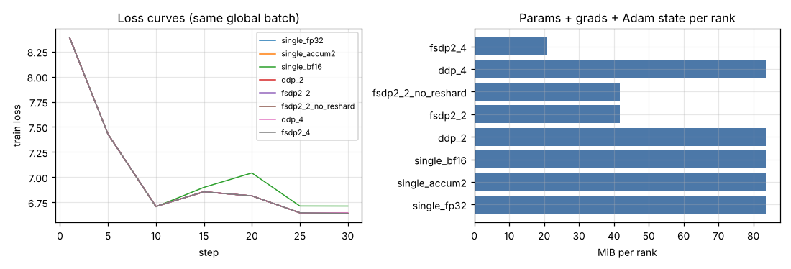
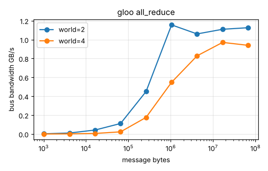
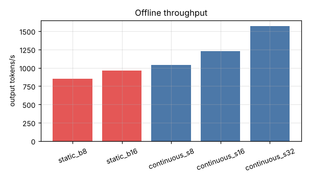
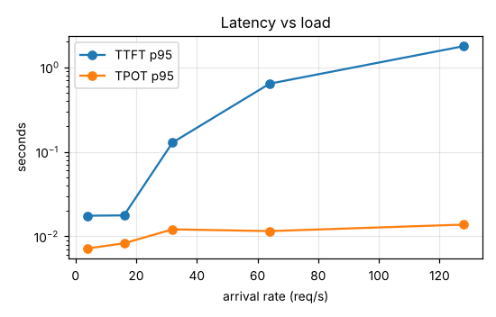
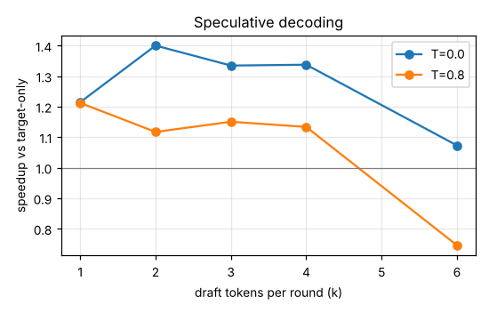

# llm-systems-lab: benchmark report

Generated by `llmlab report` from the JSON files in `results/`. Hardware and package versions
are recorded in each file's `manifest`. **All measurements below were taken on CPU**; multi-process
rows validate distributed semantics and overhead on one host, not multi-GPU scaling.

## 1. Training: single device vs DDP vs FSDP2

Host: Intel(R) Xeon(R) Processor @ 2.10GHz, 4 logical CPUs. Global batch fixed at 2048 tokens; 30 steps; CPU threads split evenly across ranks.

| run | ranks | precision | tokens/s | step s | final loss | params MiB/rank | grads MiB/rank | Adam MiB/rank | peak RSS MiB (rank 0) |
|---|---|---|---|---|---|---|---|---|---|
| single_fp32 | 1 | fp32 | 5,941 | 0.345 | 6.641 | 20.888 | 20.888 | 41.776 | 1,366 |
| single_accum2 | 1 | fp32 | 3,846 | 0.532 | 6.639 | 20.888 | 20.888 | 41.776 | 1,128 |
| single_bf16 | 1 | bf16 | 6,184 | 0.331 | 6.713 | 20.888 | 20.888 | 41.776 | 1,236 |
| ddp_2 | 2 | fp32 | 4,750 | 0.431 | 6.642 | 20.888 | 20.888 | 41.776 | 1,152 |
| fsdp2_2 | 2 | fp32 | 2,996 | 0.684 | 6.640 | 10.444 | 10.444 | 20.888 | 1,146 |
| fsdp2_2_no_reshard | 2 | fp32 | 3,530 | 0.580 | 6.640 | 10.444 | 10.444 | 20.888 | 1,143 |
| ddp_4 | 4 | fp32 | 5,253 | 0.390 | 6.647 | 20.888 | 20.888 | 41.776 | 1,002 |
| fsdp2_4 | 4 | fp32 | 3,479 | 0.589 | 6.641 | 5.222 | 5.222 | 10.444 | 963.449 |

## 2. All-reduce bandwidth (gloo, loopback TCP on one host)

| world | KiB | p50 ms | algbw GB/s | busbw GB/s |
|---|---|---|---|---|
| 2 | 1.000 | 0.380 | 0.003 | 0.003 |
| 2 | 4.000 | 0.377 | 0.011 | 0.011 |
| 2 | 16.000 | 0.387 | 0.042 | 0.042 |
| 2 | 64.000 | 0.587 | 0.112 | 0.112 |
| 2 | 256.000 | 0.582 | 0.451 | 0.451 |
| 2 | 1,024 | 0.907 | 1.156 | 1.156 |
| 2 | 4,096 | 3.956 | 1.060 | 1.060 |
| 2 | 16,384 | 15.120 | 1.110 | 1.110 |
| 2 | 65,536 | 59.588 | 1.126 | 1.126 |
| 4 | 1.000 | 4.367 | 0.000 | 0.000 |
| 4 | 4.000 | 3.202 | 0.001 | 0.002 |
| 4 | 16.000 | 3.919 | 0.004 | 0.006 |
| 4 | 64.000 | 4.225 | 0.016 | 0.023 |
| 4 | 256.000 | 2.231 | 0.117 | 0.176 |
| 4 | 1,024 | 2.870 | 0.365 | 0.548 |
| 4 | 4,096 | 7.596 | 0.552 | 0.828 |
| 4 | 16,384 | 25.931 | 0.647 | 0.970 |
| 4 | 65,536 | 107.139 | 0.626 | 0.940 |

## 3. Serving: static vs continuous batching (offline, all requests at t=0)

64 requests, prompts are prefixes of dev complaints, max_new_tokens ~ U(16,128); KV cache 6144 B/token (fp32, GQA 4 KV heads).

| system | requests | output tok/s | wall s | TTFT p50 s | TTFT p95 s | TPOT p50 s | KV peak MiB |
|---|---|---|---|---|---|---|---|
| static_b8 | 64 | 847.592 | 5.341 | 2.443 | 4.641 | 0.006 | 8.391 |
| static_b16 | 64 | 961.893 | 4.706 | 2.035 | 3.724 | 0.009 | 17.062 |
| continuous_s8 | 64 | 1,039 | 4.357 | 2.059 | 3.774 | 0.007 | 4.969 |
| continuous_s16 | 64 | 1,229 | 3.685 | 1.537 | 2.781 | 0.011 | 8.625 |
| continuous_s32 | 64 | 1,568 | 2.887 | 0.185 | 1.823 | 0.017 | 17.344 |
| no_kv_cache_sequential | 8 | 111.073 | 5.213 | - | - | - | - |
| kv_cache_sequential | 8 | 237.893 | 2.434 | 1.349 | 2.265 | 0.004 | 1.031 |

Static batches reserve KV for `batch x (longest prompt + max_new)`; the paged pool holds only
the blocks in use. `KV peak` is reserved bytes for static rows and peak used blocks for continuous rows.

## 4. Serving under load (Poisson arrivals, continuous batching, max 16 seqs)

| rate req/s | output tok/s | TTFT p50 | TTFT p95 | TPOT p50 | TPOT p95 | E2E p95 | mean seqs/step |
|---|---|---|---|---|---|---|---|
| 4.000 | 141.886 | 0.010 | 0.018 | 0.005 | 0.007 | 0.369 | 1.410 |
| 16.000 | 615.553 | 0.011 | 0.018 | 0.006 | 0.008 | 0.408 | 3.394 |
| 32.000 | 1,096 | 0.017 | 0.129 | 0.009 | 0.012 | 0.672 | 8.615 |
| 64.000 | 1,450 | 0.288 | 0.639 | 0.010 | 0.012 | 0.997 | 12.759 |
| 128.000 | 1,400 | 0.751 | 1.778 | 0.010 | 0.014 | 2.164 | 13.576 |

## 5. Prefix caching (shared 64-token system prompt)

| system | prefill tokens computed | prompt tokens from cache | TTFT p50 | TTFT p95 | output tok/s | block hits |
|---|---|---|---|---|---|---|
| continuous_s16 | 3798 | 0 | 0.469 | 1.060 | 753.464 | 0 |
| continuous_s16_prefix | 1158 | 2640 | 0.286 | 0.685 | 1,083 | 165 |

## 6. Speculative decoding (draft model, batch 1)

Target 5,475,584 params, draft 926,336 params; draft decode costs 0.41x of target decode time. 16 dev prompts x 64 tokens.

| k | temperature | acceptance | tokens / target forward | speedup | greedy outputs identical (of prompts) |
|---|---|---|---|---|---|
| 1 | 0.000 | 0.724 | 1.668 | 1.215 | 16 |
| 2 | 0.000 | 0.621 | 2.133 | 1.400 | 16 |
| 3 | 0.000 | 0.532 | 2.438 | 1.335 | 16 |
| 4 | 0.000 | 0.484 | 2.738 | 1.337 | 16 |
| 6 | 0.000 | 0.382 | 3.003 | 1.073 | 16 |
| 1 | 0.800 | 0.630 | 1.580 | 1.212 | - |
| 2 | 0.800 | 0.493 | 1.907 | 1.117 | - |
| 3 | 0.800 | 0.423 | 2.156 | 1.150 | - |
| 4 | 0.800 | 0.357 | 2.286 | 1.134 | - |
| 6 | 0.800 | 0.263 | 2.409 | 0.746 | - |

## 7. Weight quantization

LM head and embedding stay fp32 in all schemes (tied weights).

| scheme | dev perplexity | weights MiB | decode tok/s (b=1, p50) | prefill tok/s (b=16) |
|---|---|---|---|---|
| fp32 | 24.334 | 20.888 | 361.867 | 14,934 |
| bf16 | 24.333 | 10.444 | 226.321 | 43,262 |
| int8-weight-only | 24.328 | 8.287 | 239.702 | 18,465 |
| int8-dynamic | 24.856 | 8.231 | 220.387 | 26,389 |

## 8. KV-cache memory: analytic sizing (calculation, not a measurement)

Assumptions: 80.0 GB GPU, 90% usable, bf16 weights, 4096-token sequences, activations ignored.

| model | KV dtype | bytes/token | GiB per sequence | max concurrent seqs |
|---|---|---|---|---|
| llmlab target | bf16 | 3072 | 0.012 | - |
| llmlab target | fp8 | 1536 | 0.006 | - |
| Llama-3.1-8B | bf16 | 131072 | 0.500 | 104 |
| Llama-3.1-8B | fp8 | 65536 | 0.250 | 208 |
| Qwen3-8B | bf16 | 147456 | 0.562 | 92 |
| Qwen3-8B | fp8 | 73728 | 0.281 | 184 |
| Llama-3.1-8B (if MHA) | bf16 | 524288 | 2.000 | 26 |
| Llama-3.1-8B (if MHA) | fp8 | 262144 | 1.000 | 52 |

## 9. Downstream fine-tuning: LoRA vs full fine-tune vs probe vs TF-IDF (RuMedTop3 test, n=822)

| method | test Hit@1 | 95% CI | test Hit@3 | dev Hit@1 (selected) | trainable params | Adam state MiB | step s (during run) |
|---|---|---|---|---|---|---|---|
| tfidf_lr | 0.495 | [0.461, 0.530] | 0.732 | - | - | - | - |
| linear_probe | 0.253 | [0.224, 0.283] | 0.434 | 0.223 | 26985 | 0.206 | 0.176 |
| lora_r8 | 0.315 | [0.283, 0.348] | 0.528 | 0.316 | 113001 | 0.862 | 1.244 |
| full_ft | 0.338 | [0.308, 0.371] | 0.567 | 0.347 | 5502569 | 41.981 | 0.713 |

Step times in this table were recorded during the quality run, which shared the CPU with other
jobs; use the isolated timing table below for speed comparisons.

**Isolated step timing** (`llmlab bench lora timing`, idle host, batch 32 x 128):

| method | median step s | p90 step s |
|---|---|---|
| linear_probe | 0.243 | 0.285 |
| lora_r8 | 0.502 | 0.595 |
| full_ft | 0.543 | 0.629 |

## 10. Profiles (torch.profiler, CPU)

**Training step (batch 16 x 127)** - top operators by self CPU time:

| op | calls | self ms | % self |
|---|---|---|---|
| aten::mm | 129 | 198.757 | 47.131 |
| aten::mul | 244 | 38.783 | 9.197 |
| aten::_scaled_dot_product_flash_attention_for_cpu_backward | 6 | 25.648 | 6.082 |
| aten::_scaled_dot_product_flash_attention_for_cpu | 6 | 16.903 | 4.008 |
| aten::sum | 51 | 12.323 | 2.922 |
| aten::_log_softmax | 1 | 9.772 | 2.317 |
| aten::_log_softmax_backward_data | 1 | 9.731 | 2.307 |
| aten::pow | 39 | 9.145 | 2.169 |

**Engine decode step, 16 sequences** - top operators by self CPU time:

| op | calls | self ms | % self |
|---|---|---|---|
| aten::mm | 43 | 1.948 | 22.272 |
| aten::index | 43 | 0.809 | 9.245 |
| aten::_scaled_dot_product_flash_attention_for_cpu | 6 | 0.583 | 6.667 |
| aten::copy_ | 102 | 0.575 | 6.574 |
| aten::mul | 96 | 0.525 | 6.005 |
| aten::as_strided | 502 | 0.280 | 3.196 |
| aten::arange | 108 | 0.255 | 2.914 |
| aten::matmul | 43 | 0.229 | 2.615 |

Chrome traces: `results/profile_*.json.gz` (open in Perfetto / chrome://tracing).

## 11. GPU serving (vLLM / SGLang)

**Not run.** No GPU was available. The matrix and harness are in `gpu/` (`gpu/README.md`); `gpu/run_matrix.py` refuses to run without CUDA.

## Suites without results

`gpu_serving`

